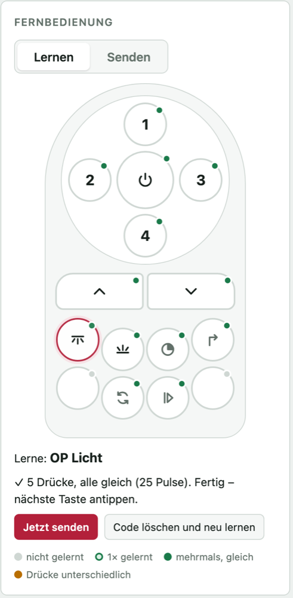

# ir-remote-lab

A small **lab for reading and analysing infrared remote controls** with an ESP32-S3
running CircuitPython: capture the raw signal of any IR remote, measure its carrier
frequency, compare repeated key presses, and send a learned signal back to check it.

It is a private learning project. My test object is an appliance I own myself: an older
kitchen hood with an IR remote (a berbel ceiling lift hood from 2013, see
[Example device](#example-device)). I am experimenting with whether such a device could
be connected to my own home-automation / IoT setup. Nothing in this repository is specific
to that device, and it contains **no codes** of any manufacturer – every user learns the
signals of their own remote.

## ⚠️ Disclaimer – no warranty, no liability

This is a private hobby project, shared **as is**, free of charge and **without any
warranty or guarantee** of any kind – express or implied – including fitness for a
particular purpose or safety. **Use entirely at your own risk.** The author accepts
**no liability** for any damage to your devices, persons or property, nor for lost
manufacturer warranty, resulting from the use or misuse of this information, hardware
design or software.

* It is **not** a replacement for the remote control supplied by a manufacturer.
* Appliances with moving parts (e.g. a motorised lift) must only be operated when you can
  see that nothing and nobody is in the way.
* Working on mains-powered appliances is dangerous – leave that to qualified people.
  This project only uses a separate low-voltage board and infrared light.
* Not affiliated with, authorised or endorsed by any manufacturer. Brand and product
  names are trademarks of their respective owners and are mentioned only to describe the
  device I tested with.

**Deutsch:** Privates Hobby- und Lernprojekt, unentgeltlich und **ohne jede Gewähr oder
Garantie** zur Verfügung gestellt. Die Nutzung erfolgt **vollständig auf eigene Gefahr**;
für Schäden jeglicher Art an Geräten, Personen oder Sachen sowie für den Verlust von
Herstellergarantien wird **keine Haftung** übernommen. Kein Ersatz für eine
Original-Fernbedienung, kein Bezug zu einem Hersteller.

See also the [LICENSE](LICENSE) (MIT), which applies to the software in this repository.

## What it does

* **Capture** – a demodulating receiver records the key code as on/off timings,
  a second, non-demodulating receiver records the raw carrier to measure its frequency.
* **Analyse** – the web page lists all captures, draws them as signal diagrams and marks
  where two presses differ; helper functions split repeated frames and find the majority.
* **Learn & replay** – tap a key on the virtual remote, press the real key 2–3 times;
  the board stores the signal and can send it again through its IR LED.
* **Self-test** – the receivers sit next to the IR LED, so every transmission is received
  again and compared with what was sent.

## Example device

I tried the lab with the IR remote of my own **berbel BDL 115 SKE** ceiling lift hood
(bought 2013). The operating manual of that hood series (German, not part of this
repository – copyright berbel) is available online, e.g.
[here (PDF)](https://www.lax-online.de/media/pdf/c6/b5/d0/berbel-BDL-SK-SKE-SKE-L-Bedienung.pdf).

The virtual remote on the web page currently uses the key layout of that remote, simply
because it was the one at hand. For another remote, change the `KEYS` list in
[`web/index.html`](web/index.html).

## Hardware

* Adafruit **QT Py ESP32-S3** (CircuitPython 10)
* **TSOP38238** IR receiver (records the demodulated code) → `RX`
* **TSMP98000** IR receiver (outputs the raw carrier, used to measure the frequency) → `TX`
* **TSAL6200** IR LED, driven by a **2N2222A**: `A3` → 220 Ω → base (10 kΩ base to GND),
  emitter to GND, collector → LED → 33 Ω → 5 V
* optional: micro-SD card on SPI with CS on `A1`, push button `A2` → GND, status LED on `A0`

A wiring diagram and a perfboard layout are in [`schaltplan.html`](schaltplan.html) (German).

## Software

| File | Purpose |
|---|---|
| `code.py` | Runs on the board: capture, learn, send, web server |
| `ir_lab.py` | Pure helper functions (carrier, frames, comparison) – runs on board and PC |
| `web/index.html` | Web page with a **virtual remote** (modes *learn* and *send*) and a capture log |
| `deploy.sh` | Copies everything to the `CIRCUITPY` drive and installs libraries via `circup` |
| `hwtest.py` | Hardware self-test from the PC over the serial REPL |
| `lauschen.py` | Listens whether the appliance itself sends IR back |
| `sim/` | Runs `code.py` on a PC with stub modules (`python sim/run.py`) |
| `test_ir_lab.py` | Unit tests (`python3 test_ir_lab.py`) |
| `loetplan/` | Generator for the perfboard layouts |

Comments and the web page are in German.

### The web remote



The page served by the board shows a virtual remote. In **Lernen** (learn) mode you tap a
key and press the same key on the real remote 2–3 times; the dot turns green when all
presses agree. In **Senden** (send) mode a tap sends the learned signal through the IR LED.
Learned signals are stored on the SD card (`/sd/codes.json`) with an optional copy in the
board's flash. They stay on your board – none are included in this repository.

<br clear="right">

### Setup

1. Install CircuitPython 10 on the QT Py ESP32-S3.
2. Create `settings.toml` on `CIRCUITPY` with your Wi-Fi (never commit this file):
   ```toml
   CIRCUITPY_WIFI_SSID = "your-network"
   CIRCUITPY_WIFI_PASSWORD = "your-password"
   # optional further networks, the strongest known one is used:
   WIFI_SSID_2 = "other-network"
   WIFI_PASSWORD_2 = "other-password"
   ```
3. `python3 -m venv .venv && .venv/bin/pip install circup pyserial`, then `./deploy.sh`.
4. Open `http://<board-ip>/` or `http://irlab.local/` (the IP is printed on the serial console).
5. Choose *Lernen* (learn), tap a key on the page, press the same key on your remote 2–3 times.

If you keep a copy of your learned signals in `captures/codes.json` (ignored by git),
`deploy.sh` also copies it to the board's flash as a fallback when the SD card is missing.

## Security

The board serves a plain-HTTP page in your home network. It is hardened against the
typical attacks on such devices:

* **No file access** – only `index.html` is served; `settings.toml` (Wi-Fi password),
  code and SD card are not reachable (path traversal is rejected).
* **Cross-site requests blocked** – every command (`POST`) must carry the header
  `X-IR-Lab: 1`. A foreign web page cannot add it without a CORS preflight, which the
  board never allows; there is no `Access-Control-Allow-Origin` header.
* **DNS rebinding blocked** – requests are only answered for the board's own IP,
  `irlab.local` and `localhost`.
* **Optional PIN** – set `IRLAB_PIN = "1234"` in `settings.toml`. All API calls then
  need the header `X-IR-Lab-Pin`; after 5 wrong PINs the API locks for 60 s. The page
  asks for the PIN once and remembers it in that browser.
* **Movement confirmation** – in send mode the page asks before the "up"/"down" keys
  (can be switched off on the page).

Limits: HTTP is unencrypted, so the PIN is visible to anyone who can sniff your Wi-Fi.
Keep guests in a separate guest network. For experiments with a home-automation system
(e.g. a Homebridge HTTP plugin) send both headers:

```
curl -X POST -H "X-IR-Lab: 1" -H "X-IR-Lab-Pin: 1234" "http://irlab.local/api/code/send?n=1"
```

`n` is the key number on the virtual remote (1 = power key, then counting through the
layout as listed in `KEYS` in `web/index.html`).

## License

MIT – see [LICENSE](LICENSE).
